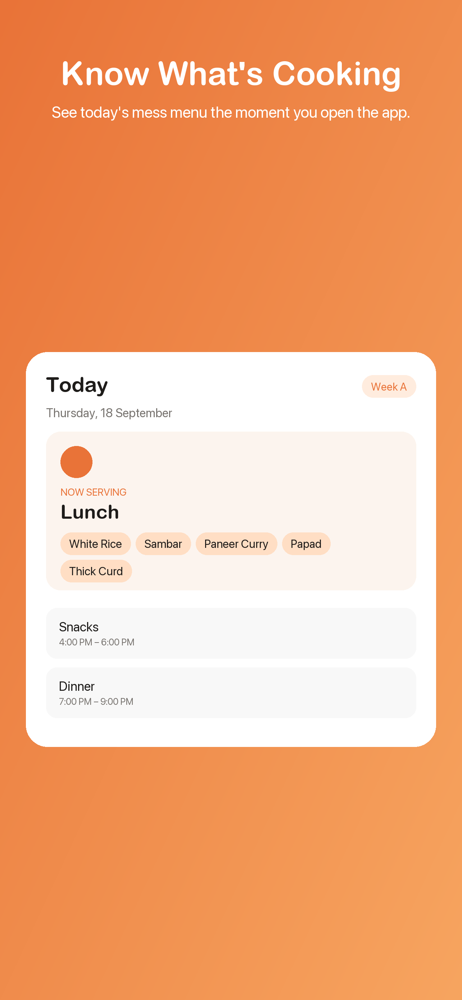
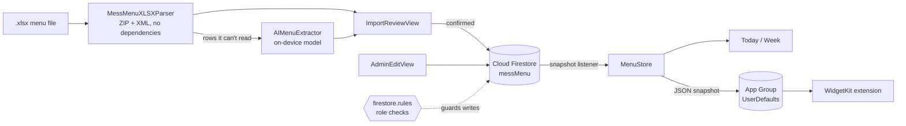

<div align="center">


# VIT AP Menu

**A native iOS app that answers the only question that matters at 12:29 PM: what's for lunch?**

Live hostel mess menus for VIT-AP, with a Home Screen widget, per-hostel operators, and an `.xlsx` importer written from scratch in Swift.


**If this saves you a trip to the notice board, or teaches you something about parsing spreadsheets by hand, please leave a ⭐. It's how other students find it.**



</div>

---

## Contents

- [Why this exists](#why-this-exists)
- [Features](#features)
- [Architecture](#architecture)
- [How we built it](#how-we-built-it)
  - [1. Modelling a menu that isn't really weekly](#1-modelling-a-menu-that-isnt-really-weekly)
  - [2. Reading .xlsx with no dependencies](#2-reading-xlsx-with-no-dependencies)
  - [3. On-device AI as a fallback, not a foundation](#3-on-device-ai-as-a-fallback-not-a-foundation)
  - [4. Scoped operators without a backend](#4-scoped-operators-without-a-backend)
  - [5. Live sync that doesn't lose data](#5-live-sync-that-doesnt-lose-data)
  - [6. A widget that never talks to the network](#6-a-widget-that-never-talks-to-the-network)
- [Bugs that taught us something](#bugs-that-taught-us-something)
- [Run it yourself](#run-it-yourself)
- [Adapting it for your campus](#adapting-it-for-your-campus)
- [Project layout](#project-layout)
- [Contributing](#contributing)

## Why this exists

VIT-AP publishes its mess menu as a monthly Excel file. To find out what's for dinner you have to find the latest file, open a very wide spreadsheet on a phone, work out which of two alternating menus applies to today's date, and hope you're reading the right hostel.

It's also more complicated than it looks: **each hostel block runs its own mess**, and **each weekday alternates between two different menus**.

So we built something that opens straight to the current meal, for your hostel, on your plan.

## Features

**For students**

- **Opens to what matters.** The current meal, or the next one, is front and centre, and it switches on its own as meal windows open and close.
- **Your hostel, your plan.** 11 blocks (MH-1 to MH-7, LH-1 to LH-4) and Regular or Special mess.
- **Full fortnight view.** Browse both alternating weeks, not just today.
- **Home Screen widget.** Small, medium and large. The large size shows the whole day.
- **Meal reminders.** A local notification before each meal starts.
- **Honest about missing data.** If a block's menu hasn't been uploaded, the app says so instead of showing sample data as if it were real.

**For the people who run the mess**

- **Import the Excel file directly.** Pick the `.xlsx` and every day, week and plan is filled in.
- **Review before publishing.** Parsed menus appear in the same UI students see. Nothing is written until you confirm.
- **Manual editor** for last-minute swaps, live for everyone once saved.
- **Scoped access.** Each operator can edit only their own hostel. The server enforces this, not just the UI.

## Architecture



| Layer | Choice | Why |
| --- | --- | --- |
| UI | SwiftUI, iOS 17+ | Native feel, small codebase |
| Data | Cloud Firestore | Real-time updates to every phone with no server to run |
| Auth | Firebase email/password | Enough for a small, known set of editors |
| Authorization | Firestore rules + an `operators` collection | Role checks with zero backend code |
| Import | Hand-written ZIP and XML reader | No third-party parser to ship or trust |
| Fallback | Apple Foundation Models (iOS 26+) | Handles format drift, and the file never leaves the device |
| Widget | WidgetKit + App Group | Keeps the Firestore SDK out of a memory-limited extension |

The whole app is about 3,000 lines of Swift, and Firebase is its only package dependency.

## How we built it

### 1. Modelling a menu that isn't really weekly

The published sheet groups dates like this:

| Row | Dates |
| --- | --- |
| Thursday | 1st, 15th, 29th |
| Thursday | 8th, 22nd |

So each weekday has two menus that alternate. The rule falls out of the dates: work out which occurrence of that weekday this date is in the month, and odd occurrences are Week A, even are Week B.

```swift
let occurrence = (dayOfMonth - 1) / 7 + 1
let cycleWeek: CycleWeek = occurrence % 2 == 1 ? .a : .b
```

No admin toggle and no "current week" stored anywhere that could go stale. It's pure arithmetic on today's date, and the importer uses the same formula on the dates in the spreadsheet, so both sides always agree.

Every menu is one Firestore document with a deterministic ID:

```text
<block>_<plan>_<weekday>_<cycleWeek>     e.g. lh3_regular_thursday_a
```

That gives 11 blocks × 2 plans × 7 days × 2 weeks = **308 documents** for the complete state of the app. Direct lookups, no queries, no indexes.

### 2. Reading .xlsx with no dependencies

An `.xlsx` file is a ZIP archive of XML, and Apple already ships both halves of what's needed to read one. [`MessMenuXLSXParser.swift`](VIT-AP%20Food%20Street/MessMenuXLSXParser.swift) is about 500 lines:

1. **Find the ZIP central directory** by scanning backwards for the end-of-central-directory signature, then walk the entries.
2. **Inflate each entry** with the `Compression` framework. ZIP stores raw DEFLATE, which is exactly what `COMPRESSION_ZLIB` decodes.
3. **Parse `sharedStrings.xml`** with Foundation's `XMLParser`, since Excel stores most text once and refers to it by index.
4. **Parse each `sheetN.xml`** into a `[row: [column: value]]` grid, turning cell references like `AB12` into column numbers.
5. **Read tab names** from `workbook.xml` and its `.rels` file, to tell which sheet is which.
6. **Turn the grid into menus.** A non-empty first column starts a new day block, and the rows beneath it are that day's items.

The parser reads meaning from the file instead of assuming a layout, because the layout changes:

- **Columns come from the header row.** Breakfast, Lunch, Snacks and Dinner are located by name, so inserting an unrelated column doesn't shift anything.
- **Weekdays are matched loosely**, so `Thu`, `Thurs` and `Thursday` are all the same.
- **Dates are scanned out of free text**, so `1, 15, 29` and `(1st & 15th, 29th)` both work.
- **Nothing is silently dropped.** A block with food in it that can't be understood is returned as `unresolved` and shown to the admin.

### 3. On-device AI as a fallback, not a foundation

It's tempting to hand the whole spreadsheet to a language model. We didn't, because deterministic code is faster, free, and can't invent a dish. Model output on a live menu has to be trustworthy.

Instead, the model only sees the blocks the parser gave up on, and only when the admin taps retry. Apple's `@Generable` and `@Guide` macros constrain the output to a typed structure, including an enum of valid weekdays:

```swift
@Generable
struct AIExtractedDay {
    @Guide(description: "Which weekday this block of spreadsheet rows describes",
           .anyOf(["monday", "tuesday", "wednesday", "thursday", "friday", "saturday", "sunday"]))
    var weekday: String
    // ...one [String] per meal
}
```

It runs entirely on-device, so the file is never uploaded, and the result still goes through the same review screen as everything else. On phones without Apple Intelligence, the raw block is shown for manual entry.

### 4. Scoped operators without a backend

Each hostel needed its own editor who could not touch anyone else's menu. Firebase custom claims are the textbook answer, but setting them requires the Admin SDK and somewhere to run it. A small collection and Firestore's `get()` needed no server at all:

```text
operators/{uid}  →  { block: "lh3" }
```

```js
function operatorAssignedBlock() {
  return get(/databases/$(database)/documents/operators/$(request.auth.uid)).data.block;
}

match /messMenu/{day} {
  allow read: if true;
  allow create, update: if idMatchesData(day) &&
    (isSuperAdmin() || isOperatorFor(request.resource.data.block));
  allow delete: if isSuperAdmin();
}
```

`idMatchesData` is the easy line to miss. Without it, an operator could write a document whose *body* says their block but whose *ID* belongs to someone else's, overwriting that hostel's menu while passing the block check.

Hiding the other blocks in the app's picker is only a convenience. The rules are the actual security boundary.

### 5. Live sync that doesn't lose data

`MenuStore` keeps one snapshot listener on the `messMenu` collection and publishes a dictionary keyed by document ID. Three details made it feel right:

- **Merge, don't replace.** Only `documentChanges` are applied, so partially filled collections don't blank out everything else.
- **Update locally on save**, so an edit shows immediately instead of waiting for the round trip.
- **Track which blocks have real data**, which powers the "hasn't been uploaded yet" banner.

### 6. A widget that never talks to the network

Widget extensions run under a tight memory budget, and the Firestore SDK is heavy. So the widget contains no networking at all:

1. Whenever `MenuStore` changes, it writes a JSON snapshot to `UserDefaults` in a shared App Group.
2. It then calls `WidgetCenter.shared.reloadAllTimelines()`.
3. The widget reads that snapshot and builds a timeline with an entry at **every meal boundary left today**, so it flips from "Up Next" to "Now Serving" by itself.

## Bugs that taught us something

Real menus are messier than sample ones. A few that shaped the code:

**Dinner was showing snacks.** One hostel's file labelled its header `Dates` instead of `Day` and added a `Style` column between Lunch and Snacks. The header check failed, the parser fell back to a hardcoded layout, and every later column landed one meal off. Tea and puffs became dinner, and the real dinner column was never read. *Lesson: a silent fallback is worse than a loud failure.*

**Two sheets, one title.** Plan detection looked for the word `SPECIAL` in the title cell, but one workbook used identical titles on both sheets, so Special data overwrote Regular. The tab name was the only reliable signal, which is why the parser now reads `workbook.xml`. *Lesson: when a file has metadata, use it.*

**Edits that reverted themselves.** The listener originally replaced the entire dictionary on each snapshot, so one write could wipe every combination not yet in Firestore. *Lesson: a snapshot of what exists is not a snapshot of what should exist.*

**Login that closed too early.** The screen dismissed as soon as Firebase said "signed in", before the app had checked whether that account had a role. It now waits for role resolution. *Lesson: authenticated and authorized are two different moments.*

**Widget builds that made a file called `.appex`.** A target added programmatically had no `PRODUCT_NAME`, and with a physical `Info.plist` Xcode won't inject standard keys like `CFBundleIdentifier` for you. *Lesson: generated targets only get what you give them.*

## Run it yourself

**You'll need** Xcode 26 or later, an Apple Developer account for the App Group, and a free Firebase project.

```bash
git clone https://github.com/High-on-codes/vitap-mess-menu.git
```

1. **Open** `VIT-AP Food Street.xcodeproj`. Swift Package Manager fetches Firebase automatically.
2. **Set your identifiers.** In both targets choose your signing team and replace `com.example.VITAPMenu` with your own bundle ID. Then create an App Group and update it in both `.entitlements` files and in `WidgetSharedStore.swift`.
3. **Create a Firebase project.** Add an iOS app with your bundle ID, then enable **Email/Password** sign-in and **Cloud Firestore**.
4. **Add your config.** Download `GoogleService-Info.plist` into the `VIT-AP Food Street` folder. It's gitignored, and `GoogleService-Info.example.plist` shows the expected shape.
5. **Set the super admin.** Replace `admin@example.com` in **both** `AppConfig.swift` and `firestore.rules`.
6. **Publish the rules** from `firestore.rules` in the Firebase console.
7. **Create the admin user** under Authentication → Users, then run the app and sign in from Settings.

**To add a block operator:** create their user in Firebase Authentication, then add a document at `operators/<their uid>` with a string field `block` set to a value such as `lh3`.

> The app shows bundled sample menus until real data has been uploaded for a block.

## Adapting it for your campus

Most of this generalises to any institution with a recurring menu or timetable:

| To change | Edit |
| --- | --- |
| Hostels or buildings | `HostelBlock` in `Models.swift` |
| Meal times | `MealType.defaultWindow` in `Models.swift` |
| Rotation rule | `CycleWeek.current(for:)` in `Models.swift`, plus the matching line in the parser |
| Spreadsheet format | `dayMenus(from:block:plan:)` in `MessMenuXLSXParser.swift` |
| Colours | `Theme.swift` |

## Project layout

The Xcode project keeps its original working name, `VIT-AP Food Street`.

```text
├── VIT-AP Food Street/
│   ├── Models.swift               Domain types and the rotation logic
│   ├── MenuStore.swift            Firestore listener, local state, widget sync
│   ├── MessMenuXLSXParser.swift   ZIP + XML .xlsx reader
│   ├── AIMenuExtractor.swift      On-device fallback for unreadable rows
│   ├── ImportReviewView.swift     Confirm parsed menus before publishing
│   ├── AdminAuthManager.swift     Sign-in and role resolution
│   ├── AdminEditView.swift        Manual editor and file import
│   ├── TodayView.swift            Current meal
│   ├── WeekView.swift             Fortnight browser
│   ├── OnboardingView.swift       First-run tour
│   ├── NotificationManager.swift  Local meal reminders
│   ├── WidgetSharedStore.swift    App Group bridge
│   └── RealMenuSeed.swift         Bundled sample data
├── MessMenuWidget/                WidgetKit extension
└── firestore.rules                Role-based access control
```

## Contributing

Issues and pull requests are welcome. Good places to start:

- Support for other hostels' spreadsheet formats (attach a sample file to an issue)
- Dietary tags for veg and non-veg items
- Lock Screen widgets
- An automated test suite for the parser

If you adapt this for another college, open an issue and tell us. We'd love to link to it.

---

<div align="center">

Independent student project. Not affiliated with or endorsed by VIT-AP University.

Released under the [MIT License](LICENSE).

**Found it useful? [Star the repo](https://github.com/High-on-codes/vitap-mess-menu) ⭐**

</div>
